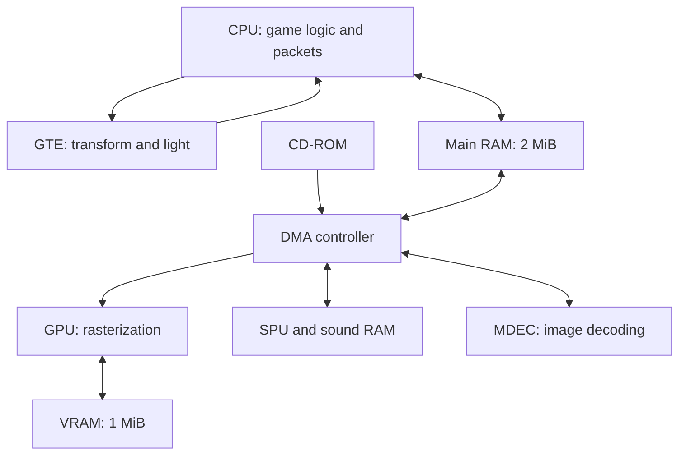

# PlayStation 1 Development Handbook

## 1. Recommended development approach

Use **PSn00bSDK with its supported MIPS GCC toolchain** as the default foundation for a custom PS1 engine. Use **PCSX-Redux with OpenBIOS** for development without distributing a Sony BIOS. Build assets offline, keep the target runtime small, and validate performance and compatibility on retail hardware. PSn00bSDK supplies C/C++ libraries, CMake integration, executable conversion, and examples covering graphics, geometry, sound, CD access, and video.[^1][^2][^3]

Two alternatives deserve serious consideration. **PSYQo**, in the `pcsx-redux/nugget` repository, is an MIT-licensed C++ framework with an application lifecycle, scenes, GPU primitives, asynchronous facilities, and fixed-point math. **spicyjpeg/ps1-bare-metal** is a compact MIT/ISC-licensed reference implementation and tutorial series for engineers who want direct control of the hardware.[^4][^5][^6]

These projects are **open source and usable without buying Sony's proprietary SDK**. They are not literally license-free: notices, source-availability provisions, and third-party terms still apply. This handbook excludes dependence on leaked PsyQ/Sony libraries, proprietary headers, retail game assets, and Sony disc-license blobs. An open-source license alone cannot establish that every distribution or console modification is lawful in every jurisdiction; the recommendations below concern documented software permissions and a workflow that avoids those proprietary dependencies.

The recommended first milestone is deliberately small: a native-resolution scene containing a textured rotating object, an independently moving camera, digital controller input, a short sound effect, and a performance overlay. Get that working before adding streaming, animation, dynamic code loading, or advanced materials.

### Reading routes

| Goal | Start with |
|---|---|
| Set up a build and understand paths | Sections 2, 6, and 7 |
| Design a 3D renderer | Sections 8–14 |
| Build an asset pipeline | Sections 12, 15, and 16 |
| Implement sound, input, and saving | Sections 17–19 |
| Optimize or diagnose failures | Sections 20–22 |
| Find implementation examples | Section 23 |

The hardware target is a **retail original PlayStation/PS one**, not a development unit, arcade derivative, PS2 compatibility mode, or an emulator with extra RAM. Technical sources and repository revisions were checked on **15 September 2026**. Exact inspected commits and evidence limitations appear in Section 25. Architecture choices, budgets, and proposed project paths are recommendations, not Sony standards or measured performance guarantees.

## 2. SDKs, licenses, and distribution boundaries

### 2.1 Tool selection

| Component | Purpose | License or permission basis | Recommendation |
|---|---|---|---|
| PSn00bSDK core | Target libraries and build integration | MPL 2.0 | Default engine backend |
| PSn00bSDK examples/template | Working starting points | MPL with additional permission for copying/modifying these examples | Start from the matching template |
| PSYQo / Nugget | Modern C++ target framework | MIT for the covered project code; inspect bundled components separately | Strong alternative when its lifecycle fits |
| ps1-bare-metal | Low-level examples and support code | MIT/ISC, including per-file notices | Best source for understanding direct hardware access |
| GCC/binutils | Cross-compilation and linking | GNU licenses; GCC runtime exception matters for linked runtime code | Use the SDK-compatible build |
| PCSX-Redux | Emulator and debugger | GPL-2.0-or-later for the emulator; components have their own notices | Development tool |
| OpenBIOS | Open-source replacement BIOS | MIT-covered project code; preserve dependency notices | Default development BIOS |
| mkpsxiso | BIN/CUE image authoring | GPL-2.0-or-later | Host build tool |
| img2tim | Image-to-TIM conversion | GPL-3.0; FreeImage dependency has separate terms | Optional host converter |
| TIMedit | Graphical TIM management | MPL 2.0 | Optional authoring aid |
| psxavenc | SPU/XA/STR encoding | zlib project license; FFmpeg dependencies have separate terms | Optional pinned host encoder; repository is archived |

License evidence comes from the projects' own notices and documentation.[^2][^4][^6][^7][^8][^9][^10][^11][^12] “Host tool” means it runs on the development computer; it is not automatically linked into the game. An emulator's GPL license also does not automatically license the independent programs it emulates.

### 2.2 MPL obligations that matter

MPL 2.0 permits a larger proprietary application containing MPL-covered files. Keep SDK changes separate and make the covered source available to recipients when distributing binaries containing it. Preserve notices and tell recipients where they can obtain that source. Your independently written game files do not automatically become MPL merely because they link to the SDK.[^13][^14]

The PSn00bSDK overview summarizes unmodified use as requiring no publication. Do not interpret that as permission to omit every distribution notice: Mozilla's FAQ Q8 expressly addresses distributing binaries compiled from unchanged MPL source. A conservative release procedure is to include the MPL notice and a durable source archive or exact source location for the SDK revision used, plus your modifications when applicable.[^2][^13]

The practical difference between the SDK choices is therefore maintenance policy. PSYQo's MIT licensing generally has simpler source-disclosure obligations. PSn00bSDK remains suitable for closed-source games if the covered-source requirements are satisfied. Neither license grants rights in unrelated Sony materials.

GCC's own license is separate from the license of a compiled program. Eligible uses of GCC runtime libraries are covered by the GCC Runtime Library Exception. Audit the actual runtime libraries shipped with your toolchain rather than assuming every archive in its installation has identical terms.[^7]

### 2.3 Keep four permissions separate

1. **Compiler and SDK:** use the named open-source projects and preserve their required notices.
2. **Firmware:** use OpenBIOS for the default emulator setup; do not bundle a Sony BIOS obtained from a download site. OpenBIOS describes a reverse-engineered implementation, not a Sony license or a universal legal certification.[^3][^12]
3. **Content:** distribute original or appropriately licensed textures, music, fonts, models, and code. A source repository's code license does not necessarily license every sample asset.
4. **Console boot method:** the ability to compile a program does not make a stock retail PS1 boot arbitrary CD-Rs. Choose an authorized development/loading route and assess the applicable rules for the actual device and jurisdiction.

Both mkpsxiso's example configuration and the PSn00bSDK template discuss optional region-specific disc-license data. **Leave that feature unused for this workflow.** Do not obtain those data from a proprietary SDK or commercial disc to complete the build. Test with direct executable loading and an appropriate homebrew-capable environment. Omitting the blob limits some boot configurations; adding it is not a substitute for permission and does not reproduce a pressed disc's physical authentication.[^15][^16]

Keep a proposed release directory containing `THIRD_PARTY_NOTICES.md`, applicable license texts, dependency revisions, asset provenance, and any required covered source. This makes permissions review repeatable instead of rediscovering dependencies at release time.

## 3. Hardware model

The PS1 is a small system of specialized processors connected through constrained memory and DMA. The CPU builds the work; the GTE accelerates geometry; the GPU rasterizes screen-space primitives; the SPU plays audio; the MDEC decodes image blocks. There is no modern graphics driver translating a general rendering API.

| Resource | Retail capability | Development implication |
|---|---|---|
| CPU | 32-bit little-endian R3000A-family MIPS core, about 33.8688 MHz | Compile for the appropriate MIPS I target; budget memory traffic and integer work |
| Floating point | No hardware FPU | Prefer fixed point in frequent calculations |
| Instruction cache | 4 KiB | Large inlined render loops can hurt |
| Scratchpad | 1 KiB | Reserve explicitly for very small, frequently used working data |
| Main RAM | 2 MiB | Code, stacks, assets, buffers, and game state share it |
| Video RAM | 1 MiB | Framebuffers, textures, CLUTs, and off-screen rendering share it |
| Sound RAM | 512 KiB | Separate budget for samples, reverb, and capture regions |
| GTE | Fixed-point coprocessor accessed with COP2 instructions | Geometry and lighting accelerator, not a rasterizer |
| GPU | Command-driven rasterizer | No hardware depth buffer or perspective-correct texture interpolation |
| SPU | 24 hardware voices | Allocate voices and sample memory explicitly |
| CD-ROM | 1×/2× sector delivery | Design sequential loading and account for seeks |
| Memory card | Typically 128 KiB | A formatted card has system overhead and 15 user blocks |

The memory map, CPU/GTE references, SPU description, and controller/card specification establish these constraints.[^17][^18][^19][^20][^21] The SDK's register definitions also provide concrete constants for implementation.[^22]



The arrows show major work/data relationships, not a cycle-accurate bus diagram. In particular, GTE results pass through CPU-managed registers and memory before becoming GPU commands; there is no automatic GTE-to-GPU rendering pipeline.

## 4. Memory map, ownership, and budgets

### 4.1 Addresses worth recognizing

| Address/range | Meaning |
|---|---|
| `0x00000000–0x001FFFFF` | Main RAM physical-address view |
| `0x80000000–0x801FFFFF` | KSEG0 view of the same retail RAM |
| `0xA0000000–0xA01FFFFF` | KSEG1 uncached view of the same RAM |
| `0x1F800000–0x1F8003FF` | Scratchpad |
| `0x1F801070`, `0x1F801074` | Interrupt status and mask |
| `0x1F801080–0x1F8010FF` | DMA registers |
| `0x1F801100`, `0x1F801110`, `0x1F801120` | Timer register blocks |
| `0x1F801800–0x1F801803` | CD controller interface |
| `0x1F801810`, `0x1F801814` | GPU GP0 and GP1/status |
| `0x1F801820`, `0x1F801824` | MDEC interface |
| `0x1F801C00` onward | SPU registers |
| `0x1FC00000–0x1FC7FFFF` | BIOS ROM physical view |

Use SDK definitions rather than duplicating these addresses throughout game code.[^17][^22] The RAM aliases are not extra memory. VRAM and sound RAM are not ordinary CPU arrays. KSEG0's caching concerns instructions; the PS1 does not have a normal data cache. Scratchpad has no KSEG1 mirror.[^17][^18]

### 4.2 A retail-memory build must enforce retail limits

The inspected PSn00bSDK `libpsn00b/ldscripts/exe.ld` starts applications at `0x80010000`, but its declared region extends to an **8 MiB** configuration for development/arcade uses. Its comments say `elf2x` warns about oversized executables. A successful link therefore does not prove that the program fits a retail console.[^23]

Add a build gate that reads the ELF's allocated sections and verifies that code, initialized data, `.bss`, heap reservations, and stack reservations fit below `0x80200000`. Do not check only the `.exe` file size: `.bss` and runtime allocations occupy RAM even when they add little or nothing to that file. If replacing the linker script, preserve startup, constructor, small-data, and SDK symbol requirements.

### 4.3 Illustrative 2 MiB plan

This is a proposed accounting example, not a measured engine footprint. Categories are non-overlapping; static allocations already counted in a subsystem must not also be counted as “code/data.”

| Allocation | KiB |
|---|---:|
| BIOS/kernel low-memory reservation | 64 |
| Executable, constants, and other static state | 384 |
| Gameplay/world state | 256 |
| Resident meshes and animation | 448 |
| Two primitive arenas | 192 |
| Two ordering tables and render scratch | 32 |
| CD read/decompression staging | 256 |
| CPU-side audio staging | 64 |
| Stacks and small temporary workspaces | 64 |
| Unallocated contingency | 288 |
| **Total** | **2,048** |

Prefer a persistent arena, a resettable scene arena, two frame arenas, and fixed-capacity pools. Make exhaustion a controlled failure with a diagnostic. Reserve the stack explicitly and measure its high-water mark. Give scratchpad one owner; a renderer and interrupt handler must not silently use the same bytes.

## 5. CPU programming, C++, and fixed point

### 5.1 What C++ support means

PS1 hardware executes machine instructions, not a source language. A suitable compiler can emit MIPS code from C or C++. PSn00bSDK includes a C++ example and runtime support; PSYQo explicitly requires C++20 in its getting-started configuration.[^24][^5] Classes, templates, RAII, and compile-time computation can all be useful. A complete desktop C++ library, operating system, and exception runtime are separate matters.

The inspected PSn00bSDK flags disable exceptions, RTTI, unwind tables, thread-safe local-static guards, and `__cxa_atexit` use. They select R3000 tuning, 32-bit ABI, and software floating point.[^25] Keep those assumptions consistent across linked libraries. Do not mix random MIPS Linux objects or libraries from a different ABI into a bare-metal program.

| Good default | Use after measuring or implementing support |
|---|---|
| Small value types and fixed-capacity arrays | Heap-heavy STL containers |
| RAII for well-defined resource lifetimes | Global constructors that access hardware before initialization |
| Templates that remove runtime branches | Many instantiations of large functions |
| Explicit status/error returns | Exceptions and unwinding |
| Handles into packed pools | Deep pointer-linked object graphs |
| Coarse virtual interfaces outside hot loops | Virtual calls per vertex or polygon |

Assembly is appropriate for a demonstrated bottleneck or a hardware operation the compiler cannot express well. It should not be the initial language for the whole engine.

### 5.2 MIPS hazards

MIPS I has branch delay slots and load delays. Handwritten assembly must also respect register preservation, stack alignment, argument areas, HI/LO dependencies, and coprocessor transfer hazards. Let the compiler and SDK wrappers manage these until a small kernel justifies manual scheduling.[^18][^26]

Do not apply modern multicore performance intuition. Contiguous data, fewer loads, smaller code, and scheduled GTE work matter more than building a general job system. Compare `-O2` and size-oriented optimization using the actual scene. A large unrolled routine may spend its theoretical arithmetic savings refilling the instruction cache.

### 5.3 Choose units before implementing the renderer

There is no single universal “PS1 fixed-point format.” GTE rotation coefficients conventionally use 12 fractional bits; vertices, translations, screen offsets, depth, and intermediate registers have different widths and interpretations. For example, screen offsets use 16 fractional bits.[^19][^27]

Recommended engine policy:

1. Store world positions in a documented signed 32-bit fixed-point unit.
2. Make cells or sectors the reference frame for large worlds.
3. Convert nearby object geometry to the narrower coordinates needed by the render path.
4. Use wider intermediates where overflow would otherwise occur, then explicitly round and clamp.
5. Test the largest permitted positions, rotations, and products on a host build.

For a generic fixed-point value with 12 fractional bits, a product conceptually becomes `wide(a) * wide(b) / 4096`. Define whether negative results truncate or round; do not rely on undefined signed overflow or assume every compiler treats negative shifts identically. Avoid a 64-bit division in every vertex calculation merely because it is mathematically convenient. Baking scale, using the GTE, or changing units may remove the operation entirely.

## 6. Toolchain setup and concrete file paths

### 6.1 Installation layout

Use a short installation path and keep build tools outside the game source. The PSn00bSDK installation guide describes these layouts:[^28]

| Item | Linux/WSL example | Windows example |
|---|---|---|
| SDK root | `/opt/psn00bsdk` | `C:\PSn00bSDK` |
| Tools added to `PATH` | `/opt/psn00bsdk/bin` | `C:\PSn00bSDK\bin` |
| `PSN00BSDK_LIBS` | `/opt/psn00bsdk/lib/libpsn00b` | `C:\PSn00bSDK\lib\libpsn00b` |
| CMake toolchain | `/opt/psn00bsdk/lib/libpsn00b/cmake/sdk.cmake` | `C:\PSn00bSDK\lib\libpsn00b\cmake\sdk.cmake` |
| Project template | `/opt/psn00bsdk/share/psn00bsdk/template` | `C:\PSn00bSDK\share\psn00bsdk\template` |
| Installed examples | `/opt/psn00bsdk/share/psn00bsdk/examples` | `C:\PSn00bSDK\share\psn00bsdk\examples` |

Use a matching SDK/toolchain release, or build from a pinned source revision and its pinned dependencies. Do not combine the newest example with an arbitrary old binary SDK. CMake 3.21 is the documented SDK baseline, but independently updated host dependencies can require newer versions. Ninja or Make is the normal target build route.[^28][^29]

Obtain SDK packages and the corresponding toolchain from the project's [release page](https://github.com/Lameguy64/PSn00bSDK/releases). Record the downloaded package version and checksum. If building the SDK itself, install its documented host prerequisites and MIPS cross-compiler first, then initialize its submodules and use its top-level CMake preset. A compiler installation alone does not install the target libraries.

For a Linux shell after installation:

```bash
export PATH="/opt/psn00bsdk/bin:$PATH"
export PSN00BSDK_LIBS="/opt/psn00bsdk/lib/libpsn00b"
mipsel-none-elf-gcc --version
cmake --version
```

For a new project, copy the installed template and build it unchanged first. Preserve its copyright and permission notices. Then rename the target and introduce the proposed layout below. The commands and configuration fragments in this handbook were checked against source/API definitions; they were not compiled or run on a PS1 as part of this report.

For example, in a new writable working directory with the SDK installed at the path above:

```bash
mkdir ps1-first-project
cp -R /opt/psn00bsdk/share/psn00bsdk/template/. ps1-first-project/
cd ps1-first-project
cmake --preset default .
cmake --build build
```

The template uses `main.c`; the later C++ layout is a deliberate adaptation. Load the resulting template executable first, then test its BIN/CUE build for the disc path.

### 6.2 Proposed project layout

| Project-relative path | Responsibility |
|---|---|
| `CMakeLists.txt` | Target executable, asset dependencies, and disc-image target |
| `CMakePresets.json` | Shared toolchain/build settings |
| `CMakeUserPresets.json` | Local installation overrides; normally untracked |
| `src/main.cpp` | Boot, initialization, and application loop |
| `src/platform/ps1/` | SDK-facing video, CD, audio, input, save, and timer adapters |
| `src/render/` | Visibility, transforms, clipping, material selection, packet assembly |
| `src/game/` | Game rules independent of SDK packet structures |
| `include/` | Stable project interfaces and generated-format definitions |
| `assets/source/` | Original authoring files |
| `assets/build/ps1/` | Generated TIMs, meshes, banks, and archives |
| `tools/` | Host asset conversion and validation |
| `disc/iso.xml` | Disc layout and source-file mapping |
| `disc/system.cnf` | Boot configuration |
| `tests/host/` | Portable math, parser, and asset-validation tests |
| `third_party/` | Pinned dependencies if vendored |
| `licenses/` | Required third-party notices and license texts |
| `build/ps1-debug/` | Generated debug artifacts |
| `build/ps1-release/` | Generated release artifacts |

These are proposed paths. They are not claimed to exist in PSn00bSDK. The verified upstream path catalog is in Section 23.

### 6.3 Small CMake configuration

The following assumes `src/main.cpp` contains your adapted, working SDK template. It intentionally does not invent a full game implementation.[^29][^30]

```cmake
cmake_minimum_required(VERSION 3.21)
project(ps1_game LANGUAGES C CXX ASM)

set(CMAKE_C_STANDARD 11)
set(CMAKE_CXX_STANDARD 17)
set(CMAKE_CXX_STANDARD_REQUIRED ON)

psn00bsdk_add_executable(game GPREL src/main.cpp)

psn00bsdk_add_cd_image(
    game_disc game disc/iso.xml
    DEPENDS game "${PROJECT_SOURCE_DIR}/disc/system.cnf"
)
```

```bash
cmake -S . -B build/ps1-debug -G Ninja \
  -DCMAKE_TOOLCHAIN_FILE=/opt/psn00bsdk/lib/libpsn00b/cmake/sdk.cmake \
  -DCMAKE_BUILD_TYPE=Debug
cmake --build build/ps1-debug
```

`GPREL` enables small-data addressing for a normal static executable. It is not the right choice for an executable that needs the SDK's dynamic-linking arrangement. Follow the SDK's `NOGPREL`/dynamic documentation when adding that feature.[^29]

| Output | Use |
|---|---|
| `game.elf` | Symbolic debugging and section inspection |
| `game.exe` | PS-X EXE target executable; not a Windows program |
| `game.map` | SDK-generated symbol map, including dynamic lookup use |
| `game.bin` and `game.cue` | Disc image and track description |

If a detailed GNU linker allocation report is needed, request a separate linker map. Do not assume the SDK's symbol map is the same thing as a full section-placement report.

### 6.4 PSYQo alternative

PSYQo's canonical setup adds `nugget` as a submodule, compiles with C++20, and includes `third_party/nugget/psyqo/psyqo.mk` from a Makefile. Start from `psyqo/examples/hello/hello.cpp`, then study `cube`, `gte`, and `cdrom-demo`. Its framework owns the main loop through `Application`, `Scene`, and `GPU`; integrate your engine into that lifecycle instead of running two competing loops.[^5][^31]

## 7. Files, boot configuration, and disc layout

### 7.1 The three different meanings of a path

| Path | Where it exists |
|---|---|
| `assets/build/ps1/level01.pak` | Host filesystem before packaging |
| `\DATA\LEVEL01.PAK;1` | ISO9660 path used by a CD-facing interface |
| An offset inside `LEVEL01.PAK` | Your own archive format |

Do not pass a host path to the console. Choose uppercase 8.3 filenames and shallow directories for the baseline disc. Some APIs accept paths without the explicit ISO version suffix; use the syntax documented by the particular SDK function. BIOS paths such as `cdrom:\GAME.EXE;1` and higher-level SDK search paths are related conventions, not interchangeable strings for every API.[^16][^32]

### 7.2 Minimal image configuration

`disc/system.cnf`:

```ini
BOOT = cdrom:\GAME.EXE;1
TCB = 4
EVENT = 10
STACK = 801FFFF0
```

The stack value follows the conventional retail-RAM template. It does not reserve stack space against the heap by itself. Keep startup and linker assumptions consistent.

`disc/iso.xml`, used with the CMake target above:

```xml
<?xml version="1.0" encoding="utf-8"?>
<iso_project>
  <track type="data">
    <identifiers system="PLAYSTATION"
                 application="PLAYSTATION"
                 volume="PS1_GAME"
                 volume_set="PS1_GAME"
                 publisher="INDEPENDENT_DEVELOPER" />
    <directory_tree>
      <file name="SYSTEM.CNF" type="data"
            source="${PROJECT_SOURCE_DIR}/disc/system.cnf" />
      <file name="GAME.EXE" type="data" source="game.exe" />
      <dummy sectors="1024" />
    </directory_tree>
  </track>
</iso_project>
```

The SDK processes the XML with CMake before invoking mkpsxiso, so `${PROJECT_SOURCE_DIR}` is expanded. Other relative source paths are resolved from the build directory. Add each generated asset as a build dependency when adding it to the image; otherwise changing the asset may not rebuild the disc.[^16][^30] The padding mirrors the template's conservative layout. It is not license data, authentication, or a universal boot requirement.

### 7.3 Executable and archive formats

PS-X EXE has a header describing loading and execution, with a `PS-X EXE` identifier and a 2,048-byte header area. Let the SDK converter produce it. An ELF contains information valuable to host tools that the BIOS executable format does not preserve.[^33]

For game assets, use a small indexed archive rather than opening hundreds of individual files during gameplay. A proposed archive index can contain an asset ID, type, version, offset, stored length, decoded length, alignment, and checksum. Validate every range before use. Prefer offsets to serialized pointers; never dump a host C++ object containing native pointers or vtables directly into a PS1 asset.

## 8. Engine architecture

The SDK is a hardware abstraction, not a complete game engine. Build a small runtime around the systems your game actually needs.

| Subsystem | Owns | Boundary |
|---|---|---|
| Platform | Initialization, interrupts, timing, diagnostics | One owner for each low-level service |
| Renderer | VRAM plan, frame contexts, GTE state, command lists | Consumes prepared visible geometry |
| Resource manager | Asset IDs, residency, loading state | Explicitly separates RAM, VRAM, and SPU residency |
| World | Cells, object transforms, collision data | Produces candidate visible objects |
| Animation | Pose or vertex-frame evaluation | Bounded work per character |
| Audio | Voice assignment, SPU allocation, streams | One scheduler coordinates CD-dependent audio |
| Input/save | Controller state and persistent data | Does not block the render loop indefinitely |
| Host pipeline | Conversion, packing, validation | Does expensive content preparation offline |

Recommended processing order:

1. Sample or latch input and advance simulation using a documented time step.
2. Identify visible cells, then visible objects.
3. Select mesh LOD, animation detail, and texture residency.
4. Transform surviving geometry and clip where necessary.
5. Choose material state, generate packets, and establish drawing order.
6. Submit the completed frame and service asynchronous work while ownership permits.

A cross-platform engine should expose concepts such as `MeshHandle`, `TextureHandle`, `Material`, and `RenderItem` to game code. Its PS1 backend translates these into fixed-point transforms, primitive packets, and ordering tables. Do not force every console backend to imitate a modern shader pipeline. Similarly, avoid making gameplay code depend directly on `POLY_FT3` just because the first backend is PS1.

For 2D games, start with ordered sprites, tiles, and texture pages. There is no need to run all screen-space UI through the GTE. For compact 3D scenes, an object list plus bounding volumes may be sufficient. Add portals, a BSP, or a spatial grid only when the world structure justifies it.

## 9. GTE geometry and lighting pipeline

### 9.1 The useful instructions

| Operation | Purpose | Typical role |
|---|---|---|
| `RTPS` | Rotate, translate, and project one vertex | Single vertex or the fourth vertex of a quad |
| `RTPT` | Transform/project three vertices | Triangle batches |
| `MVMVA` | Matrix/vector multiply with selectable operands | Transform and matrix-related work |
| `NCLIP` | Signed projected triangle-area calculation | Winding/backface test |
| `AVSZ3`, `AVSZ4` | Scaled average depth | Ordering-table bucket selection |
| `NCS`, `NCT`, `NCCS`, `NCCT` | Lighting/color operations | Normal-based lighting variants |
| `DPCS`, `DPCT` | Depth-cue color interpolation | Fog/color blending |

The GTE reference lists nominal execution times of 15 cycles for `RTPS` and 23 for `RTPT`. These are instruction timings, not complete vertex costs: register transfers, memory traffic, clipping, lighting, packet writing, and stalls remain.[^19][^34] Use `libpsn00b/include/inline_c.h` and the SDK's GTE example to learn the wrapper conventions.[^35]

`NCLIP` does **not** generate clipped polygons. Its name is easy to misread. It provides an area/winding result. `AVSZ3`/`AVSZ4` do not implement a depth buffer; they help choose a scalar ordering key.

### 9.2 A practical transform path

For each visible object, compose the model-to-camera transform once. For each visible vertex batch, load the correct matrix and translation, run the GTE, and save projected positions/depths into a bounded scratch array. Packet assembly then references that array. This avoids transforming every shared mesh vertex again for every face.

The alternative is a face-at-a-time path like the introductory cube examples: load three vertices, run `RTPT`, cull, project a fourth vertex if needed, and emit the packet. It is easy to implement and can be good for tiny meshes. The tradeoff is repeated transforms when adjacent faces share vertices.[^27][^35]

Choose using measurements. A transformed-vertex cache consumes RAM and extra stores/loads. For a very small mesh, saving redundant transforms may not compensate for that bookkeeping. Keep both implementations behind one mesh interface until profiling establishes the useful crossover.

### 9.3 Respect the GTE FIFOs

The projected XY FIFO has three entries and the Z FIFO has four. If projecting a quad as three vertices plus one, save the earliest XY result before the fourth projection shifts it out. This is demonstrated explicitly in the bare-metal cube.[^27]

Do independent integer work while a GTE operation runs when it is safe: advance packet pointers, fetch face metadata, or prepare the next index. Do not overwrite an operand or result register still in use. Use the documented pipeline behavior and inspect disassembly before assuming an inline wrapper creates useful overlap.[^34]

### 9.4 Near-plane handling

The GTE perspective division saturates for vertices that are too close or behind the camera; it does not manufacture a valid polygon at the near plane. The reference describes the projection quotient's limit around `SZ <= H/2` in the relevant GTE units.[^19]

Recommended policy:

1. Choose a near plane safely inside the projection range and document its relationship to world units and focal length.
2. Classify geometry against that plane in camera space.
3. Reject wholly excluded faces.
4. Clip crossing edges before final projection, interpolating UVs and colors consistently.
5. Triangulate the surviving polygon and enforce a cap on generated vertices/packets.

Clipping a triangle can produce a quadrilateral; reserve space for the expanded output. Keep an unclipped fast path for the common case. If an early prototype rejects crossing faces rather than clipping them, label the resulting holes as an intentional limitation, not a GTE defect.

### 9.5 Lighting policy

Bake lighting into textures or vertex colors for static scenes. Use a small amount of dynamic directional lighting for characters or important objects. The SDK cube demonstrates loading light and color matrices and accounting for model rotation.[^35] Normals and lights must be in compatible coordinate spaces; nonuniform scaling requires particular care and is best baked into exported geometry for a simple engine.

Lighting is an artistic and performance choice. Flat face lighting reduces color work and packet size. Gouraud shading improves smooth surfaces but adds per-vertex color data. Depth cueing can conceal the far cutoff, but it does not remove the need to reject distant geometry before packet creation.

## 10. GPU commands and primitives

### 10.1 Command interface

`GP0` carries drawing commands and transfer data. `GP1` configures display/control state; reading its address returns GPU status. Drawing commands consume integer screen coordinates, colors, UVs, and packed state fields. The GPU has no programmable vertex/pixel shaders, and texture interpolation is affine.[^36]

The useful implementation references are `psxgpu.h` for SDK structures and `ps1/gpucmd.h` for explicitly constructed command words.[^37][^38] Prefer one abstraction within a subsystem. Mixing raw register writes into an active SDK drawing queue can violate the queue's assumptions.

### 10.2 Primitive choices and RAM cost

The following sizes follow the inspected PSn00bSDK packet declarations and command lengths. They include one four-byte linked-list tag per standalone primitive, not external batching or additional state packets.[^37]

| Type | Geometry/material | GP0 payload words | Bytes including tag |
|---|---|---:|---:|
| `POLY_F3` | Flat-color triangle | 4 | 20 |
| `POLY_FT3` | Textured triangle, one modulation color | 7 | 32 |
| `POLY_G3` | Gouraud triangle | 6 | 28 |
| `POLY_GT3` | Textured Gouraud triangle | 9 | 40 |
| `POLY_F4` | Flat-color quad | 5 | 24 |
| `POLY_FT4` | Textured quad, one modulation color | 9 | 40 |
| `POLY_G4` | Gouraud quad | 8 | 36 |
| `POLY_GT4` | Textured Gouraud quad | 12 | 52 |

For example, 2,000 standalone `POLY_GT3` packets require **80,000 bytes per frame arena**, or 160,000 bytes for two arenas before ordering tables, UI, clipping expansion, and state commands. This is a memory calculation, not a claim that 2,000 such triangles will meet a particular frame rate.

Use `TILE` for untextured screen-aligned rectangles and `SPRT` for suitable textured rectangles. Use polygons when rotation, arbitrary shape, or scaling requires them. A quad can reduce command overhead relative to two separately tagged triangles, but vertex ordering and interpolation behavior must match the hardware. The bare-metal cube documents the required strip-like four-vertex arrangement.[^27][^37]

### 10.3 Packet allocation must be bounded

Allocate commands from a four-byte-aligned frame arena. Reserve space before writing a packet, initialize its command fields, then link it into its ordering bucket. Avoid overflow checks that happen only after already writing outside the buffer.

```text
reserve_packet(bytes):
    rounded = align_up(bytes, 4)
    if rounded > capacity - used:
        increment packet_overflow_count
        return failure
    result = arena + used
    used += rounded
    return result
```

This is design pseudocode. In the actual implementation, also validate size arithmetic and initialization of `used/capacity`. Drop an optional particle or diagnostic primitive predictably when its quota is exceeded; do not corrupt the next subsystem's memory.

Store immutable mesh/material information separately from mutable frame packets. Prebuilding command templates can save work, but a packet that is still owned by DMA cannot be patched for the next frame.

## 11. Ordering tables, visibility, and clipping

### 11.1 Painter's-order rendering

The normal PS1 approach draws distant surfaces before nearby surfaces. An ordering table is an array of linked-list heads, usually representing depth buckets. `ClearOTagR` prepares a reverse chain; primitives inserted with `addPrim` become part of that chain; submission starts at the appropriate end. Equal-bucket insertion reverses insertion order.[^39][^37]

For a proposed 2,048-bucket table with four-byte entries:

- One table costs 8,192 bytes.
- Two tables cost 16,384 bytes.
- Clearing more buckets has a cost even if most are empty.

Pick bucket count from visible depth range and observed artifacts. More buckets reduce quantization collisions but cannot correctly sort intersecting polygons or cyclic overlap. Splitting problem geometry, spatial partitioning, and deliberate level layout can help where increasing OT size cannot.

The GPU's DMA linked-list header includes the next address and payload length. Use SDK tag helpers; do not serialize host addresses into it. An ordering table is CPU/DMA data in main RAM, not a hidden GPU Z buffer.[^38][^39]

### 11.2 Visibility first

Recommended rejection order:

1. Invisible rooms/cells or out-of-range world regions.
2. Object bounding sphere/box against the camera volume.
3. Backfaces and wholly clipped geometry.
4. Tiny or deliberately omitted detail based on LOD policy.
5. Remaining primitive generation.

This avoids using GTE, packet memory, DMA, and rasterization for work with no visible contribution. Do not implement expensive fine-grained occlusion tests before cheap coarse rejection is effective.

### 11.3 Affine distortion and subdivision

Because interpolation lacks perspective correction, a large receding surface can show texture distortion. Subdivision reduces the distance over which one affine interpolation must approximate the desired perspective mapping.[^36] It also increases vertex transforms, packets, and sorting work.

Start with offline subdivision of large floors, walls, and roads. Add runtime subdivision only for clearly visible cases, using projected size and depth variation as signals. Use consistent shared-edge decisions to avoid cracks. Give subdivision a strict per-frame budget and preserve the unclipped, unsubdivided fast path for small faces.

Do not attempt to hide every wobble by tessellating the entire scene. Good world scale, stable transforms, thoughtful camera movement, and texture design can produce a better result for much less work.

### 11.4 Transparent objects require depth reasoning too

Without a depth buffer, the familiar modern sequence “all opaque geometry, then all transparent geometry” is not generally correct. A transparent surface behind an opaque foreground object must not blend over that foreground object. Place it in a compatible painter's order, split it into suitable depth groups, or use a scene-specific ordering solution.

Similarly, sorting the entire world by texture page can break visibility even if it improves texture locality. Batch materials only within groups whose reordering is known to be safe. Give HUD/UI a separate explicit final order; keep world-space effects in world depth order.

## 12. VRAM, textures, palettes, and display buffers

### 12.1 VRAM layout

VRAM is a 1,024 × 512 array of 16-bit storage units. Framebuffer regions and texture regions are allocations within that same array. A sensible initial layout is two 320 × 240 framebuffers stacked vertically, with texture allocations to their right.[^41][^40]

| Region | X | Y | Width | Height | Bytes |
|---|---:|---:|---:|---:|---:|
| Framebuffer A | 0 | 0 | 320 | 240 | 153,600 |
| Framebuffer B | 0 | 240 | 320 | 240 | 153,600 |
| Remaining space, before texture packing | — | — | — | — | 741,376 |

The byte totals are calculated as width × height × 2. The remaining space is fragmented: it is not a single universally usable texture rectangle. Texture-page alignment, CLUT placement, debug fonts, off-screen effects, and planned streaming regions further constrain it.

For this layout, reserve texture storage from `x=320` onward and explicit CLUT rows, such as part of the bottom 32 rows, subject to texture-page boundaries. Treat the debug font loaded by `FntLoad` as a real VRAM allocation. The SDK template places it at `(960,0)`, so an atlas placed there would overwrite it.[^40]

### 12.2 Texture representation

| Texture mode | Stored color information | Bytes for 256 × 256 texels, excluding palette | VRAM width for that image |
|---|---|---:|---:|
| 4 bpp | 16-entry CLUT indices | 32,768 | 64 words |
| 8 bpp | 256-entry CLUT indices | 65,536 | 128 words |
| 16-bit storage | 15-bit RGB plus control bit | 131,072 | 256 words |

A 4 bpp palette adds 32 bytes; an 8 bpp palette adds 512. These calculated sizes follow the indexed representations illustrated by the bare-metal texture/palette examples.[^41][^42]

Texture coordinates are eight-bit texel coordinates within a page. Page origins use 64-word horizontal and 256-line vertical steps; a 256-texel-wide texture's physical width depends on its bit depth. CLUT X must be aligned to 16 words. A generic image packer that treats VRAM words and texture texels as interchangeable will produce invalid layouts.[^41][^42]

Example: a 64 × 64 image at 4 bpp occupies a 16 × 64 rectangle in VRAM words. `RECT.w` for its upload is 16, while the sprite's image width is 64 texels. Keep both dimensions in asset metadata.

### 12.3 TIM loading

TIM is a convenient container for texture data, optional palettes, and upload coordinates. It does not make an image resident merely by loading the file into RAM. The sequence is: parse the TIM, upload its pixel block, upload its CLUT when present, wait for source-buffer ownership to be released, and then retain the page/CLUT/UV metadata.[^43]

The relevant PSn00bSDK APIs are `GetTimInfo`, `LoadImage`, `getTPage`, and `getClut`. `LoadImage` queues asynchronous work. The implementation copies the rectangle metadata into internal storage, but it does not copy the entire source image for you. The pixel buffer must remain alive until the transfer finishes.[^43]

A concrete version trap: `doc/known_bugs.md` still describes a 32-byte transfer-multiple restriction. The inspected `image.c` selects smaller DMA chunks for many nonmatching lengths. However, it still warns about an odd count of 16-bit pixels and divides the count by two. For a predictable pipeline, generate an even VRAM-word pixel count and aligned source buffers, or write and test an upload implementation that correctly handles padded final words. Do not repeat the stale 32-byte claim as a universal hardware rule.[^43][^44]

### 12.4 Transparency is not ordinary RGBA

Texture color `0x0000` is transparent. This refers to the decoded color, not necessarily palette index zero. `0x8000` can represent black whose behavior depends on the primitive's semi-transparency setting. Index zero may be an ordinary visible color if its CLUT entry is nonzero.[^36]

Make the exporter distinguish three intentions: a skipped texel, an opaque texel, and a texel eligible for semi-transparency. An arbitrary PNG alpha channel cannot be copied directly into PS1 texture memory. Quantization must also avoid turning an intended dark opaque color into transparent zero.

### 12.5 Texture locality and manual mipmaps

The GPU has a small texture cache, so locality matters.[^17] Reuse pages and palettes within visibility-safe groups, keep recurring effects resident, and avoid uploading a complete atlas every frame. A larger atlas does not guarantee better cache behavior.

PS1 has no automatic hardware mipmap selection. The bare-metal `10_mipmaps` example supplies prebuilt mip levels and chooses them in software using projected-size information.[^45] A production exporter should supply mip rectangles and UV transforms, plus guard texels where needed. Select levels with hysteresis so small camera movements do not cause distracting switching. Nearest-neighbor mip levels reduce shimmer; they do not create trilinear filtering or perspective correction.

## 13. Materials, blending, and special effects

### 13.1 A compact material model

Recommended material fields are primitive family, texture-page handle, CLUT handle, raw-versus-modulated texture mode, flat/Gouraud color policy, semi-transparency enable/mode, culling mode, and explicit ordering policy. Keep these as compact data interpreted by a few packet-writing kernels.[^37][^38]

| Effect | Practical PS1 method | Main cost or limitation |
|---|---|---|
| Static surface lighting | Baked texture or vertex color | Additional asset variants or color data |
| Moving character lighting | GTE normal/color operations | CPU/GTE work |
| Fog | Depth-cued vertex colors | Does not clip or cull geometry |
| Fire/glow | Additive textured primitives | Fill and ordering |
| Darkening/shadow patch | Subtractive or half-blended primitives | Approximation and overlap artifacts |
| Water | UV motion, palette motion, simple reflection passes | Extra state and fill |
| Mirror/security display | Render to an off-screen VRAM region | Extra scene render and careful synchronization |
| Palette animation | CLUT updates | Shared-palette ownership |

These are implementation options, not claims that all are free or equally appropriate.

### 13.2 Blend equations

For background `B` and foreground `F`, the four semi-transparency modes are approximately `B/2 + F/2`, `B + F`, `B - F`, and `B + F/4`, with fixed-precision channel behavior and saturation. Textured semi-transparency also depends on the texel control bit. Modulated textures use neutral vertex RGB around `(128,128,128)`, not white `(255,255,255)`.[^36]

Do not expose an arbitrary 0–255 alpha slider as though the PS1 had a general alpha blend unit. Map an authored material to one of the available modes, a cutout, a dithered pattern, or an explicitly accepted multipass approximation. Preview the result through the same quantization and blend assumptions used at runtime.

### 13.3 Off-screen rendering

The SDK's `graphics/render2tex` example shows how to draw into VRAM and reuse the resulting region as a texture.[^46] This supports useful effects, but the texture is still subject to page/UV restrictions and shares memory with every other allocation.

Treat the off-screen result as unavailable until rendering is complete. Apply the appropriate texture-cache invalidation before sampling updated content, and avoid reading the same region that is being modified. Drawing-area and offset changes require special care: the SDK queue documentation describes state commands that can take effect outside normal FIFO sequencing. Use separate synchronized chunks for such transitions rather than blindly chaining multiple render targets.[^47]

## 14. Frame lifecycle, DMA, and synchronization

### 14.1 There are three separate completions

| Event | Establishes | Does not automatically establish |
|---|---|---|
| CPU finishes packet generation | The command list is complete | DMA has consumed it |
| DMA transfer completes | The transfer has finished reading its source | GPU has rasterized every submitted primitive |
| GPU completion marker is processed | Prior rendering reached that ordered marker | Display is currently in vertical blank |
| VBlank occurs | A useful display-switch opportunity | Rendering has finished |

PSn00bSDK's software drawing queue can complete operations using DMA IRQ or GPU IRQ, depending on the operation. Its documentation specifically distinguishes transfer completion from drawing completion.[^47]

This means `DrawSync` must be interpreted in the context of the queued operation, not treated as a magical barrier with identical guarantees for every submission method. Study the `DrawOTagIRQ`/`DrawOTagEnvIRQ` family and the required terminal GPU IRQ primitive before designing a custom multi-pass frame graph. A completion-IRQ path needs an IRQ command placed at the actual end of execution order; forgetting it can leave the queue waiting forever.

### 14.2 Safe two-buffer design

Maintain two CPU frame contexts and two VRAM framebuffers. Each frame context owns its OT, packet arena, draw-environment storage, and any upload staging that the submitted work references. Track each context as available, being built, submitted, or reclaimable.

```text
initialize both VRAM framebuffers and frame contexts
display one initialized framebuffer

for each simulation/render step:
    acquire a CPU context whose previous DMA reads are complete
    build commands for the non-displayed render target
    submit using the SDK's supported synchronization contract
    service work that does not modify submitted resources
    wait for confirmed render completion
    switch display to the finished target during VBlank
    make the previous display target available for a future render
```

This conservative pseudocode prioritizes correctness. To overlap next-frame CPU work, build into the second context while the GPU processes the first, and retain every resource until its true last consumer completes. Do not reset both frame arenas at the start of every frame.

Double buffering is two ownership problems: packet memory in main RAM and image memory in VRAM. Solving only the VRAM half can still produce random corruption when DMA follows overwritten links.

### 14.3 DMA channels and contention

| DMA channel | Function |
|---:|---|
| 0 | MDEC input |
| 1 | MDEC output |
| 2 | GPU |
| 3 | CD-ROM |
| 4 | SPU |
| 5 | Expansion/PIO |
| 6 | Ordering-table clear |

DMA reduces CPU-driven transfer work, but it competes for memory access. The hardware reference describes CPU progress during DMA as restricted by cache, scratchpad, register-only work, and transfer gaps; reads from RAM and a full write queue can stall it.[^48]

Therefore “GPU and CPU overlap” is a scheduling objective, not a guarantee that their times simply become `max(CPU,GPU)`. Measure combined operation, including CD/SPU transfers. Large texture uploads can disturb a frame even if polygon counts remain unchanged.

### 14.4 Interrupt discipline

Keep callbacks short: acknowledge or capture state, update a small ring or flag, and return. Do allocation, decompression, logging bursts, and game logic in the main loop. Do not call a function that waits for an interrupt while interrupts are disabled or from an incompatible callback. PSn00bSDK documents such restrictions for both draw operations and CD reads.[^47][^32]

Shared state needs an explicit concurrency contract even on one CPU: an interrupt can observe a partially updated multi-field structure. Use a short critical section or a carefully designed producer/consumer handoff. `volatile` alone does not make an arbitrary data structure safe.

## 15. Asset pipeline and file formats

### 15.1 Do expensive conversion on the host

Recommended pipeline:

1. Import original meshes, images, animation, and sound into host tools.
2. Normalize axes, scale, winding, pivots, and transforms.
3. Bake unsupported effects, reduce geometry, and build LODs/collision data.
4. Quantize textures and reserve transparent/semi-transparent colors intentionally.
5. Pack texture pages and palettes using a VRAM-aware allocator.
6. Quantize geometry and animation into explicitly versioned binary formats.
7. Encode audio/video and assemble streaming-friendly archives.
8. Produce manifests and reject invalid output before disc authoring.

The target should not parse FBX, a full glTF scene graph, PNG, or a general authoring format during ordinary gameplay. Keep conversion deterministic: identical inputs, options, and pinned tool versions should produce identical output bytes where the tools support it.

### 15.2 Useful existing formats

| Format | Use | Advice |
|---|---|---|
| TIM | Textures and optional CLUT metadata | Good starting format; understand VRAM units |
| TMD | Established PS1 model interchange | Optional; a custom runtime mesh may be simpler |
| SMD/SMX in PSn00bSDK tooling | SDK-associated model conversion/drawing path | Inspect implementation and exporter compatibility before adopting |
| VAG / raw SPU-ADPCM | Sample containers or encoded sample data | Match encoder header/loop conventions to the player |
| XA-ADPCM | Disc-streamed audio | Requires correct sector layout and filtering |
| STR | Sectorized video stream | Match encoder format to decoder and authoring mode |
| Custom PAK | Indexed game resources | Prefer offset-based, bounded, versioned records |

File-format references describe TIM/TMD/VAG and other established containers; the SDK tools include an SMX exporter and SMD support.[^33][^49] Understanding a format does not confer rights to assets stored in someone else's files.

### 15.3 Proposed mesh representation

Use a mesh header with format version, vertex/face counts, bounds, offsets, and section sizes. Store compact vertex positions; per-face or per-corner UVs/colors; material indices; and a small number of primitive variants. Keep collision geometry independent of render geometry when their optimization goals differ.

For rigid objects, shared positions plus indexed faces are a good starting point. UV seams and hard normals can require separate corner attributes even when the geometric position is shared. For animation, begin with rigid hierarchical parts or low-rate vertex frames. General weighted skinning is possible in software/GTE-assisted code, but the cost per vertex must be justified.

Define byte order and field widths explicitly. Do not depend on compiler struct padding, host `long` width, or implicit packing pragmas. Validate the decoded counts before multiplying them by record sizes, and reject truncated or out-of-range offsets.

### 15.4 Export validation

Every asset build should check:

- All mesh indices are in range and no unsupported face remains.
- Quantized coordinates fit the chosen target representation.
- Winding and quad ordering match the renderer.
- Texture rectangles, page-local UVs, and CLUTs fit their allocations.
- Required source buffers meet DMA alignment and length rules.
- Transparent-zero and semi-transparency bits reflect the intended art.
- Peak decoded size fits the intended arena, including temporary overlap.
- Every non-original asset has a recorded author/license/source.

The bare-metal repository's `tools/convertImage.py` is a useful readable starting point for raw image conversion; `img2tim` and TIMedit provide existing TIM workflows.[^6][^9][^10][^50] Treat the older SDK Blender exporter as source to evaluate, not a promise of compatibility with every current Blender release.

## 16. CD loading and streaming

### 16.1 Throughput and latency

For ordinary 2,048-byte user-data sectors, the nominal arithmetic is 75 sectors/s × 2,048 = **153,600 B/s at 1×** and twice that, **307,200 B/s at 2×**. These are about 150 and 300 KiB/s. Raw sector size and XA Form 2 payload sizes differ.[^51]

A contiguous 256 KiB asset therefore has an idealized 2× transfer time of about **0.853 seconds**, before seek time, retries, scheduling, or decompression. This calculation explains why texture/model loads cannot be treated like ordinary desktop file reads.

Build streaming around regions the player is likely to enter. Load ahead through doors, corridors, or level transitions. Place resources used together near each other in disc order. Validate behavior with realistic CD timing; a host filesystem shortcut can conceal a broken loading design.

### 16.2 One owner for the drive

The resource loader, XA player, video player, and any SPU streaming source must coordinate. They cannot each issue independent seeks whenever they want. A recommended scheduler maintains one active transfer plan, cancellation state, bounded retry policy, and a priority queue of upcoming reads.

Use `CdSearchFile` for initial lookup of a small number of archive files, then keep offsets and sector ranges in your own index. The SDK header explicitly recommends avoiding frequent file searches and documents asynchronous `CdRead`/`CdReadRetry`/`CdReadSync` behavior.[^32]

Allocate buffers for the number of whole sectors read, not just the file's nominal byte length. Maintain separate stored and decoded lengths. Wait for read completion before decoding, and keep DMA destination buffers stable until completion. A timeout should produce a recoverable loading/error state rather than an infinite spinner with no diagnostic.

### 16.3 Compression tradeoff

Compression saves disc bandwidth and potentially resident memory, but consumes CPU time and decode workspace. Evaluate total load time:

`seek + transfer(compressed bytes) + decode + upload + synchronization`

For streaming, account for the worst moment when compressed input, decoded output, and GPU/SPU upload staging coexist. Splitting an asset into independently decodable chunks can be worth a small compression-ratio loss if it lowers peak memory and reduces long stalls.

## 17. Audio and the SPU

The SPU mixes 24 voices from its separate 512 KiB RAM, with hardware envelopes, pitch control, and reverb facilities. Its native sample encoding uses 16-byte ADPCM blocks representing 28 decoded samples. CD audio has a related but distinct playback path; a container or stream called “ADPCM” is not automatically SPU sample data.[^20]

### 17.1 Sample loading

The PSn00bSDK `sound/vagsample` example parses a VAG header, uploads sample data, configures a voice, and triggers playback. It reserves the first 4 KiB for capture-related use and accounts for the SDK's dummy sample at `0x1000`, beginning subsequent sample allocation at `0x1010`.[^52] Reverb can require another reserved region. Do not allocate samples over either area.

Preserve alignment and pad source allocations to the actual transfer size. If an API rounds a transfer up, the source buffer must contain those padded bytes; merely increasing the requested length can read beyond the input. Parse VAG header byte order explicitly rather than assuming all its multi-byte fields match the little-endian CPU.

At 22,050 decoded samples/s, mono ADPCM data requires approximately `22050 × 16 / 28 = 12,600 B/s`, excluding headers and padding. Thus a two-second mono effect is about 25,200 bytes. This is an encoding-size calculation, not a complete SPU allocation estimate.

### 17.2 Voice and bank policy

Recommended voice priorities are player feedback, dialogue, important world events, then ambience and cosmetic sounds. On voice exhaustion, steal a low-priority quiet/old voice or decline the new sound predictably. Avoid stopping a critical effect just because a particle spawned another impact sample.

Use resident banks for common sounds and per-scene banks for uncommon sounds. Store looping metadata alongside sample addresses. Test clicks at loop boundaries and during voice stealing. Lowering sample rate can save substantial memory, but evaluate the actual material rather than applying one rate to every sound.

The SDK has both RAM-to-SPU and CD-to-SPU streaming examples.[^53] Start with resident effects. Introduce streaming only after measuring buffer refill deadlines alongside rendering and CD activity. A large loading operation that starves an audio ring is an engine scheduling issue, not simply a sound-driver bug.

### 17.3 Encoding tools

psxavenc supports raw SPU data, VAG variants, XA, and STR formats. The inspected WonderfulToolchain repository was archived on 12 January 2026; pin and validate it rather than presenting it as actively maintained. Its README also warns that XA/STR sectorized output needs appropriate disc authoring and that some formats require additional interleaving.[^11]

For an initial audio conversion, its documented raw-SPU pattern is:

```bash
psxavenc -t spu -f 22050 source.wav effect.snd
```

Provide an appropriate mono input and validate the resulting sample in the target player. A host encoder can process modern media formats; that does not mean the PS1 runtime can decode those originals.

## 18. MDEC and full-motion video

The MDEC is a specialized image-block decoder with inverse quantization, inverse transform, and color-conversion functions. It is not a general MPEG/H.264/MP4 decoder and does not replace the CPU's entire compressed-stream processing job.[^54]

PSn00bSDK's STR player demonstrates a pipeline in which CD sectors are assembled, the CPU decodes variable-length codes into run-length data, the MDEC processes that data, and decoded image slices are uploaded to VRAM. Several stages need separate buffers and coordinated ownership.[^55]

Recommended first video target: a short, modest-resolution clip with a conservative frame rate and matching audio format. Treat the complete media stream as a bandwidth allocation problem, including sector headers, audio interleave, worst-case compressed frame size, and decode time. Average file size alone does not guarantee uninterrupted playback.

Use the SDK's video example as an integration reference, but inspect its options. Its comments describe a VSync tradeoff and a 24-bit display option. **24-bit display does not enable ordinary 24-bit GPU polygon rendering**; the example only adds its normal GPU text overlay in 16-bit mode.[^55] A video player and a game renderer must deliberately hand off video mode, VRAM allocations, audio state, and CD ownership on entry and exit.

## 19. Controllers, memory cards, interrupts, and video timing

### 19.1 Controller input

Controller and memory-card communication uses the console's peripheral serial interface. Digital buttons are conventionally reported as active-low bits; analog controllers require handling their identification/configuration and additional axis bytes.[^21]

Normalize all devices into an engine input state: held, pressed, released, axes, connection state, and controller capabilities. Re-read device identity after disconnection. Apply dead zones and stick calibration deliberately. Treat rumble as optional and disable it cleanly when a controller disappears.

For implementation references, inspect PSn00bSDK's `io/pads`, the bare-metal `11_controllers`, and PSYQo's `padtest`/`multitap` examples.[^56] Low-level polling varies across emulator implementations, so validate your chosen driver with the actual controllers you intend to support. Do not silently assume an emulator's gamepad mapping proves DualShock protocol correctness.

### 19.2 Memory-card saves

A standard card is organized into sixteen 8 KiB blocks, with one block reserved for filesystem/system information and fifteen for ordinary save allocations. A game's usable payload is smaller than its allocated blocks after its headers, icon, and metadata.[^21]

Recommended save record fields are a format identifier, schema version, length, sequence number, checksum, and explicit game-state fields. Handle no card, full card, wrong card, removal, corrupt data, and incompatible versions as normal states. Never automatically format a card because a read failed.

For resilience, preserve an older valid record until the new one has been written and validated. Two alternating records with sequence numbers and checksums can improve recovery, but only within the guarantees of the actual card/filesystem operations. Do not claim power-loss atomicity without testing interruption at each write stage.

**Destructive example warning:** the inspected PSYQo `psyqo/examples/memorycard/memorycard.cpp` is an interactive API test whose first test action formats the card in port 1. Study its implementation with a disposable emulator card image; do not run that action on a card holding saves you care about.[^57]

### 19.3 Interrupts and timers

The PS1 has three hardware timer/root-counter units with selectable clock sources and interrupt behavior. Timer 2 can use the system clock divided by eight; the units are 16-bit counters.[^58] Configure one timing scheme and use it consistently. Preserve timer ownership when integrating an SDK service that already uses one.

At the nominal CPU clock, a full 65,536-count interval at CPU/8 is about **15.48 ms**. A single raw 16-bit timestamp subtraction therefore cannot measure an arbitrarily long frame without accounting for wraparound. Extend the counter, count interrupts, or choose another measurement strategy.

Use the SDK's interrupt layer unless replacing the kernel is an explicit project. Low-level exception handling must preserve execution state and account for hardware quirks; arbitrary interrupt acknowledgement can interfere with BIOS-driven services.[^26][^59]

### 19.4 PAL, NTSC, and aspect ratio

Choose a conservative native gameplay mode such as 320 × 240 on a suitable NTSC setup, and implement/test a PAL configuration explicitly. Nominal 60 Hz and 50 Hz families are useful planning categories; exact timings depend on configuration. Do not derive game speed from “one simulation step per VBlank” unless differing regional speeds are intentional.

Use fixed simulation intervals or elapsed-time accumulation, cap catch-up work, and handle missed frames gracefully. Interlaced modes require field-aware behavior and consume more render/VRAM budget. Keep the visible safe area and final display aspect ratio in mind when laying out UI. The SDK template and bare-metal GPU setup provide concrete starting points for display geometry.[^40][^60]

## 20. Performance engineering

### 20.1 Establish a measured budget

Use frame time as the primary budget. At a nominal 60 updates/s, a frame interval is 16.67 ms; at 30 it is 33.33 ms. At 50 it is 20 ms, and at 25 it is 40 ms. These are arithmetic targets; actual presentation timing needs the selected video mode.

At 33.8688 MHz, a 1/60-second interval contains about 564,480 CPU clock cycles. They are not all useful instructions: memory waits, DMA contention, exceptions, and synchronization consume the interval. For a richer first 3D game, targeting 30/25 presentation rates may buy valuable headroom. A lean 2D or simple 3D game may justify 60/50. Choose from content and measurements.

Track CPU simulation, visibility, transforms, packet generation, actual GPU completion, CD waits, audio refill, packet bytes, and peak allocation. Separate active processing from waiting for VBlank. Otherwise an optimization can appear to have no effect simply because the program still waits for the same presentation boundary.

### 20.2 Optimization order

1. **Remove unnecessary work:** visibility, distance limits, inactive simulation, and off-screen effects.
2. **Reduce geometry processing:** shared transforms, LOD, simpler animation, and fewer clipped faces.
3. **Reduce packet work:** compact primitive types, prepared immutable state, efficient arena allocation.
4. **Reduce pixel work:** overdraw, large translucent effects, high-resolution passes, and oversized UI layers.
5. **Reduce data movement:** texture residency, compact assets, fewer staging copies, sequential CD reads.
6. **Tune the hottest kernels:** data layout, code size, GTE scheduling, then targeted assembly.

A fixed polygon-per-second headline is not a usable performance specification. Two scenes with the same triangle count can have very different projected pixel coverage, texture locality, blend cost, clipping work, and CPU overhead.

### 20.3 Controlled experiments

| Experiment | What an improvement suggests | Confounder to control |
|---|---|---|
| Remove texture sampling from equivalent geometry | Texture/fill contribution | Primitive command and shading changes |
| Disable large transparent effects | Blend/overdraw cost | Keep CPU effect simulation comparable |
| Lower rendering resolution | Pixel processing is significant | Viewport, visibility, and presentation changes |
| Reuse precomputed screen-space geometry | Transform/visibility CPU cost | Identical command count and coverage |
| Disable streaming during the same scene | DMA/CD/decode contention | Asset residency and timing changes |
| Reduce OT bucket count | OT clear/management cost | Increased ordering artifacts |
| Compare `-O2` with size-oriented code | Instruction-cache/code-size effects | Same toolchain and content |

These are diagnostic hypotheses. Confirm a change with repeated runs of the same camera/input sequence and inspect both frame-time distribution and visible correctness. A test that merely proves “fewer things are faster” does not identify which subsystem needs work.

### 20.4 Patterns worth keeping

Use compact sequential arrays for render input. Prefer a few specialized packet writers over a branch-heavy universal material function. Keep commonly referenced textures resident. Reuse palette variants when appropriate. Quantize animation data to its actual visual requirements. Precompute bounds, face metadata, and static transforms on the host.

Avoid LTO as an assumed safe default for PSn00bSDK: its own notes warn about weak assembly functions and allocation overrides.[^26][^44] PSYQo documents an LTO build mode, but that is a separate toolchain/framework configuration; one project's support does not prove another project's compatibility.[^5]

## 21. Debugging and hardware validation

### 21.1 PCSX-Redux workflow

PCSX-Redux offers a CPU debugger, a GDB server, VRAM inspection, and GPU command logging. Its documentation requires the debugger to be enabled and the interpreter to be selected for CPU debugging; GPU tools can be useful independently of that setting.[^61]

1. Boot the development configuration using OpenBIOS.
2. Load the game's executable and retain the matching ELF.
3. Enable CPU debugging and the GDB server when source stepping is needed.
4. Connect a MIPS-capable GDB to the configured endpoint.
5. Set a breakpoint at `main` or a platform initialization boundary.
6. Inspect the first invalid address or malformed packet, not only the later crash.

The documented default GDB port is 3333. If the executable is already loaded, a basic attach uses:[^62]

```text
file build/ps1-debug/game.elf
target remote localhost:3333
break main
```

Reset/reload the executable as appropriate so execution reaches the breakpoint. Use the documented `monitor` and loading commands for your emulator build when automating startup; do not assume an ordinary process-style `run` command creates a console process.

### 21.2 Graphics inspection

Use the VRAM viewer to compare the real allocations with the planned map: framebuffers, font, textures, palettes, and off-screen targets.[^63] Use GPU logging to examine the command order and the VRAM changes caused by each operation.[^64]

Useful in-engine diagnostics include clipped/rejected/visible face counts, emitted packets, bytes remaining, maximum OT occupancy, current texture pages, CD request state, audio underruns, and arena high-water marks. Make counters cheap enough to keep in development builds. Keep expensive printf output outside frequently executed interrupts.

### 21.3 Test native behavior

Disable geometry correction, enhanced resolution, overclocking, instant-CD options, and extra-memory settings when evaluating whether a program meets retail constraints. Enhanced emulator output can be a separate convenience profile, but it must not become the compatibility test.

Use an actual retail console for release validation when practical. Document model/region, loader, controllers, memory card, display mode, and reproduction steps. A PS2 or another platform's emulator is an additional compatibility target, not an automatic substitute for a PS1.[^6]

Direct executable loading is the fastest initial iteration loop. A disc-image build is still necessary to test real file lookup, sector layout, boot configuration, and streaming. Keep both paths functioning so “works when injected into RAM” is not mistaken for “works as a disc-based game.”

## 22. Common failure modes

| Symptom | Likely causes | First useful inspection |
|---|---|---|
| Black screen | Display disabled, bad environment, no valid startup, overwritten framebuffer | Break at `main`; inspect display state and VRAM |
| Random polygon corruption | Packet arena overflow, bad DMA tags, reused submitted memory | Bounds counters and chain addresses |
| Geometry explodes near camera | Saturated projection, missing near clipping, wrong units | Camera-space Z and GTE flags |
| Faces appear inside out | Winding mismatch or wrong quad vertex order | Single untextured face and signed-area result |
| Faces pop through each other | Painter's-order limitations, equal buckets, intersecting geometry | OT bucket/order visualization |
| Texture has wrong colors | Wrong CLUT, wrong page depth, palette overwritten | VRAM in the relevant indexed mode |
| Texture is stretched or shifted | Texel versus VRAM-word confusion, bad page-local UVs | Exported texture metadata |
| Black parts disappear | Color quantized to `0x0000` | Actual CLUT/pixel values |
| Everything is too bright | Modulation color treated as ordinary full-white neutral | RGB modulation fields |
| Tearing | Display swap before render completion or outside intended boundary | GPU completion versus VBlank timeline |
| `DrawSync` never returns | Missing expected IRQ, malformed list, bad transfer, overwritten data | Queue mode and final command |
| CD read overwrites memory | Allocated file length but requested rounded-up sectors | Destination capacity and sector count |
| CD streaming breaks music | Competing reads/seeks or audio ring starvation | Single drive scheduler trace |
| Save corruption | Removal, interrupted update, wrong card handling, unvalidated lengths | Disposable-card interruption test |
| Emulator works, console fails | Timing/interrupt assumptions, loading method, memory overrun | Native settings and retail ELF memory gate |
| Smaller source still uses too much RAM | `.bss`, decode overlap, frame arenas, stack, or embedded assets | ELF sections plus runtime high-water marks |

Treat these as a triage map, not a diagnosis from symptoms alone. Several visible failures share a root cause in memory ownership.

## 23. Verified source-code and example catalog

Paths below are relative to the named repository root and were present in the inspected revisions. Read source comments and license notices before reusing code or assets. “Reference” does not mean the example is production-ready or independently hardware-tested here.

### PSn00bSDK

Repository: [Lameguy64/PSn00bSDK](https://github.com/Lameguy64/PSn00bSDK). The example index describes the learning purpose and known limitations of included examples.[^65]

| Path | What to learn |
|---|---|
| `template/main.c` | Frame contexts, primitive storage, debug text |
| `template/CMakeLists.txt`, `template/iso.xml`, `template/system.cnf` | Build-to-disc path |
| `libpsn00b/include/psxgpu.h` | Packet layouts and graphics API |
| `libpsn00b/include/psxgte.h`, `libpsn00b/include/inline_c.h` | Geometry types and GTE wrappers |
| `libpsn00b/include/psxcd.h` | CD commands, reads, and callback contracts |
| `libpsn00b/include/psxspu.h` | SPU interface |
| `libpsn00b/include/hwregs_c.h` | MMIO addresses and hardware constants |
| `libpsn00b/ldscripts/exe.ld` | Startup layout and the 8 MiB linker-region caveat |
| `libpsn00b/cmake/flags.cmake` | Actual compilation assumptions |
| `libpsn00b/psxgpu/image.c` | Upload ownership, DMA chunking, TIM parsing |
| `doc/drawing_queue.md` | DrawOp sequencing and GPU/DMA IRQ distinction |
| `examples/beginner/hellocpp/main.cpp` | C++ adaptation of basic rendering |
| `examples/graphics/gte/main.c` | Textured GTE cube and lighting |
| `examples/graphics/fpscam/main.c` | Camera calculations |
| `examples/graphics/billboard/billboard.c` | Sprites in 3D space |
| `examples/graphics/render2tex/main.c` | Off-screen VRAM rendering |
| `examples/graphics/tilesasm/` | Assembly tile-rendering reference |
| `examples/cdrom/cdbrowse/main.c` | Directory navigation |
| `examples/sound/vagsample/main.c` | Sample upload and voice playback |
| `examples/sound/spustream/`, `examples/sound/cdstream/` | Streaming sources and buffering |
| `examples/mdec/strvideo/main.c` | Integrated video pipeline |
| `examples/system/dynlink/` | Dynamic loading; advanced and optional |
| `examples/system/timer/main.c` | Hardware timer usage |
| `tools/plugin/io_export_smx_v3.py` | Exporter source to study/adapt |

### PSYQo / Nugget

Repository: [pcsx-redux/nugget](https://github.com/pcsx-redux/nugget).

| Path | What to learn |
|---|---|
| `psyqo/GETTING_STARTED.md` | Toolchain and Makefile setup |
| `psyqo/CONCEPTS.md` | Application, scene, primitives, fragments |
| `psyqo/psyqo.mk` | Build integration |
| `psyqo/examples/hello/hello.cpp` | Minimal application |
| `psyqo/examples/hello-chained/` | Chained GPU work |
| `psyqo/examples/cube/`, `psyqo/examples/gte/` | 3D and geometry usage |
| `psyqo/examples/cdrom-demo/` | CD access |
| `psyqo/examples/coroutine-demo/`, `psyqo/examples/task-demo/` | Asynchronous control flow |
| `psyqo/examples/padtest/`, `psyqo/examples/multitap/` | Controller handling |
| `psyqo/examples/memorycard/memorycard.cpp` | Card API; first test action formats the card |
| `openbios/` | Open-source BIOS implementation |
| `openbios/COMPATIBILITY.md` | Documented compatibility scope |

Do not follow the separate `psyq/` integration route as part of this handbook's open-SDK workflow. PSYQo and PsyQ are different things; similarity in their names does not make proprietary PsyQ libraries open source.

### Bare-metal learning sequence

Repository: [spicyjpeg/ps1-bare-metal](https://github.com/spicyjpeg/ps1-bare-metal).

| Path | Topic |
|---|---|
| `src/00_helloWorld/main.c` | Startup and serial output |
| `src/01_basicGraphics/main.c` | Initial GPU commands |
| `src/02_doubleBuffer/main.c` | Alternating image buffers |
| `src/03_dmaChain/main.c` | RAM command chains and DMA |
| `src/04_textures/main.c` | Direct-color uploads and addressing |
| `src/05_palettes/main.c` | Indexed textures and CLUTs |
| `src/06_fonts/main.c` | Atlas/font rendering |
| `src/07_orderingTable/main.c` | Ordering-table construction |
| `src/08_spinningCube/main.c` | GTE projection and quad handling |
| `src/09_faceLighting/main.c` | Lighting |
| `src/10_mipmaps/main.c` | Software-selected mip levels |
| `src/11_controllers/main.c` | Peripheral communication |
| `src/common/gpu.c`, `src/common/gte.c` | Shared support implementation |
| `src/ps1/gpucmd.h`, `src/ps1/gte.h`, `src/ps1/registers.h` | Low-level command/register definitions |
| `tools/convertImage.py` | Host image conversion |

Follow the sequence in order when learning direct hardware access. For engine work, use the examples to explain the corresponding SDK abstraction rather than immediately replacing every SDK service.

## 24. Implementation roadmap and acceptance criteria

| Stage | Deliverable | Acceptance criterion |
|---|---|---|
| 1. Reproducible boot | Pinned SDK/toolchain, template build, OpenBIOS execution | Clean checkout produces the executable; symbols match |
| 2. Retail constraints | RAM/VRAM plan and memory build gate | No allocated region or reservation exceeds retail limits |
| 3. 2D renderer | Bounded packets, two frame contexts, ordered sprites/text | No corruption or arena overflow during a long deterministic run |
| 4. Basic 3D | Camera, GTE transforms, culling, textured mesh | Stable mesh under rotation, translation, and camera motion |
| 5. Geometry robustness | Near clipping, LOD, explicit ordering policy | Close-camera and intersecting-geometry test scenes behave as designed |
| 6. Asset pipeline | Mesh/texture/audio conversion and manifests | Bad inputs fail before runtime; generated records are bounds-checked |
| 7. Disc resources | Archive lookup and staged loading | Disc build works independently of executable injection |
| 8. Audio/input/save | Resident sounds, controller states, resilient save format | Removal/full-card/error paths tested using disposable saves |
| 9. Performance pass | Repeatable scene traces and bottleneck experiments | Meets selected frame-time target with reserve under worst intended content |
| 10. Release validation | Hardware matrix, dependency notices, covered source where required | Repeatable build, documented compatibility, and complete attribution |

For the first engine version, defer general dynamic linking, weighted skinning, large video sequences, and sophisticated real-time reflections. Each can be added later behind an explicit budget. The most useful early asset is a small representative test level that stresses the rendering and loading patterns the eventual game will actually use.

## 25. Revisions, evidence, and limits

The following default-branch revisions were inspected directly. The table records what was reviewed, not a claim that a particular binary release contains the same code.

| Repository | Inspected commit | Commit date |
|---|---|---|
| PSn00bSDK | `5d9aa2d3dfc7d6e51c2eb942ab4cdbae5571a40a` | 2025-01-28 |
| Nugget / PSYQo / OpenBIOS | `625da805c4a9bfd56dd9b2b17409805c0591dd42` | 2026-09-09 |
| ps1-bare-metal | `33df9422bd5191def47f631b6fe2ffa647822502` | 2026-09-13 |

Hardware facts primarily come from the community-maintained PSX-SPX reference and the original implementation work in the cited repositories. PSX-SPX is reverse-engineering documentation, not an official Sony support contract. SDK source and license texts take precedence over an old tutorial's summary when behavior or obligations differ.

The documented conflict checks include PSn00bSDK's outdated upload-size warning versus its implementation, the broad executable linker region versus retail RAM, and the distinction between DMA completion and GPU completion. OpenBIOS compatibility is not assumed to equal every retail BIOS behavior. The PSYQo memory-card example's formatting operation is explicitly marked.

No included command sequence was end-to-end compiled or run on hardware for this report. Memory calculations are derived examples; performance policies are engineering recommendations requiring measurement. This is a platform-development handbook with selected source paths, not an exhaustive register encyclopedia, complete engine implementation, or jurisdiction-specific legal opinion.

## Sources

Numbered notes below link to the original publications or implementation files. Repository links for the three inspected codebases are pinned to the revisions above where practical. Living web references and other project pages were accessed on 15 September 2026; unknown publication dates are not inferred from crawl dates.

[^1]: PSn00bSDK contributors. [PSn00bSDK overview](https://github.com/Lameguy64/PSn00bSDK/blob/5d9aa2d3dfc7d6e51c2eb942ab4cdbae5571a40a/README.md). Inspected revision `5d9aa2d3dfc7`.

[^2]: PSn00bSDK contributors. [PSn00bSDK licenses and example permissions](https://github.com/Lameguy64/PSn00bSDK/blob/5d9aa2d3dfc7d6e51c2eb942ab4cdbae5571a40a/LICENSE.md). Inspected revision `5d9aa2d3dfc7`.

[^3]: PCSX-Redux authors. [OpenBIOS documentation](https://pcsx-redux.consoledev.net/openbios/).

[^4]: PCSX-Redux authors. [Nugget MIT license](https://github.com/pcsx-redux/nugget/blob/625da805c4a9bfd56dd9b2b17409805c0591dd42/LICENSE). Inspected revision `625da805c4a9`.

[^5]: PCSX-Redux authors. [PSYQo getting started](https://github.com/pcsx-redux/nugget/blob/625da805c4a9bfd56dd9b2b17409805c0591dd42/psyqo/GETTING_STARTED.md). Inspected revision `625da805c4a9`.

[^6]: spicyjpeg. [PlayStation 1 bare-metal C examples, including license statement](https://github.com/spicyjpeg/ps1-bare-metal/blob/33df9422bd5191def47f631b6fe2ffa647822502/README.md). Inspected revision `33df9422bd51`.

[^7]: GNU Project. [GCC runtime licensing and Runtime Library Exception](https://gcc.gnu.org/onlinedocs/libstdc++/manual/license.html).

[^8]: PCSX-Redux contributors. [Emulator license](https://github.com/grumpycoders/pcsx-redux/blob/main/LICENSE).

[^9]: Lameguy64. [img2tim overview and license](https://github.com/Lameguy64/img2tim). See also [LICENSE](https://github.com/Lameguy64/img2tim/blob/master/LICENSE).

[^10]: Lameguy64. [TIMedit overview and project license](https://github.com/Lameguy64/TIMedit).

[^11]: WonderfulToolchain / psxavenc contributors. [psxavenc usage and format notes](https://github.com/WonderfulToolchain/psxavenc). Repository archived 12 January 2026. See [zlib license](https://github.com/WonderfulToolchain/psxavenc/blob/main/LICENSE).

[^12]: PCSX-Redux authors. [OpenBIOS implementation and MIT notice](https://github.com/pcsx-redux/nugget/blob/625da805c4a9bfd56dd9b2b17409805c0591dd42/openbios/main/main.c). Inspected revision `625da805c4a9`.

[^13]: Mozilla. [MPL 2.0 FAQ, particularly Q8–Q11](https://www.mozilla.org/en-US/MPL/2.0/FAQ/). FAQ states last updated 30 January 2024.

[^14]: Mozilla. [Mozilla Public License 2.0, Sections 2–3](https://www.mozilla.org/en-US/MPL/2.0/).

[^15]: mkpsxiso contributors. [Example disc-authoring XML and optional license-data discussion](https://github.com/Lameguy64/mkpsxiso/blob/master/examples/example.xml).

[^16]: PSn00bSDK contributors. [Disc layout template](https://github.com/Lameguy64/PSn00bSDK/blob/5d9aa2d3dfc7d6e51c2eb942ab4cdbae5571a40a/template/iso.xml). Inspected revision `5d9aa2d3dfc7`.

[^17]: Martin Korth and PSX-SPX contributors. [Memory Map](https://psx-spx.consoledev.net/memorymap/).

[^18]: Martin Korth and PSX-SPX contributors. [CPU Specifications](https://psx-spx.consoledev.net/cpuspecifications/).

[^19]: Martin Korth and PSX-SPX contributors. [Geometry Transformation Engine](https://psx-spx.consoledev.net/geometrytransformationenginegte/).

[^20]: Martin Korth and PSX-SPX contributors. [Sound Processing Unit](https://psx-spx.consoledev.net/soundprocessingunitspu/).

[^21]: Martin Korth and PSX-SPX contributors. [Controllers and Memory Cards](https://psx-spx.consoledev.net/controllersandmemorycards/).

[^22]: PSn00bSDK contributors. [Hardware register definitions and CPU clock](https://github.com/Lameguy64/PSn00bSDK/blob/5d9aa2d3dfc7d6e51c2eb942ab4cdbae5571a40a/libpsn00b/include/hwregs_c.h). Inspected revision `5d9aa2d3dfc7`.

[^23]: PSn00bSDK contributors. [Executable linker script](https://github.com/Lameguy64/PSn00bSDK/blob/5d9aa2d3dfc7d6e51c2eb942ab4cdbae5571a40a/libpsn00b/ldscripts/exe.ld). Inspected revision `5d9aa2d3dfc7`.

[^24]: PSn00bSDK contributors. [C++ basic graphics example](https://github.com/Lameguy64/PSn00bSDK/blob/5d9aa2d3dfc7d6e51c2eb942ab4cdbae5571a40a/examples/beginner/hellocpp/main.cpp). Inspected revision `5d9aa2d3dfc7`.

[^25]: PSn00bSDK contributors. [Compiler and linker flags](https://github.com/Lameguy64/PSn00bSDK/blob/5d9aa2d3dfc7d6e51c2eb942ab4cdbae5571a40a/libpsn00b/cmake/flags.cmake). Inspected revision `5d9aa2d3dfc7`.

[^26]: Lameguy64 and spicyjpeg. [Development notes](https://github.com/Lameguy64/PSn00bSDK/blob/5d9aa2d3dfc7d6e51c2eb942ab4cdbae5571a40a/doc/dev_notes.md). Inspected revision `5d9aa2d3dfc7`.

[^27]: spicyjpeg. [GTE cube, coordinate formats, FIFOs, and quad ordering](https://github.com/spicyjpeg/ps1-bare-metal/blob/33df9422bd5191def47f631b6fe2ffa647822502/src/08_spinningCube/main.c). Inspected revision `33df9422bd51`.

[^28]: PSn00bSDK contributors. [Installation and project creation](https://github.com/Lameguy64/PSn00bSDK/blob/5d9aa2d3dfc7d6e51c2eb942ab4cdbae5571a40a/doc/installation.md). Inspected revision `5d9aa2d3dfc7`.

[^29]: PSn00bSDK contributors. [CMake reference](https://github.com/Lameguy64/PSn00bSDK/blob/5d9aa2d3dfc7d6e51c2eb942ab4cdbae5571a40a/doc/cmake_reference.md). Inspected revision `5d9aa2d3dfc7`.

[^30]: PSn00bSDK contributors. [CMake executable, binary embedding, and disc-image implementation](https://github.com/Lameguy64/PSn00bSDK/blob/5d9aa2d3dfc7d6e51c2eb942ab4cdbae5571a40a/libpsn00b/cmake/internal_setup.cmake). Inspected revision `5d9aa2d3dfc7`.

[^31]: PCSX-Redux authors. [PSYQo application, scene, and GPU concepts](https://github.com/pcsx-redux/nugget/blob/625da805c4a9bfd56dd9b2b17409805c0591dd42/psyqo/CONCEPTS.md). Inspected revision `625da805c4a9`.

[^32]: PSn00bSDK contributors. [CD API contracts and file lookup](https://github.com/Lameguy64/PSn00bSDK/blob/5d9aa2d3dfc7d6e51c2eb942ab4cdbae5571a40a/libpsn00b/include/psxcd.h). Inspected revision `5d9aa2d3dfc7`.

[^33]: Martin Korth and PSX-SPX contributors. [CDROM File Formats, including PS-X EXE, TIM, TMD, and VAG](https://psx-spx.consoledev.net/cdromfileformats/).

[^34]: PSX-SPX contributors. [GTE Pipeline Timings](https://psx-spx.consoledev.net/gtepipelinetimings/).

[^35]: PSn00bSDK contributors. [Textured GTE cube and lighting example](https://github.com/Lameguy64/PSn00bSDK/blob/5d9aa2d3dfc7d6e51c2eb942ab4cdbae5571a40a/examples/graphics/gte/main.c). Inspected revision `5d9aa2d3dfc7`.

[^36]: Martin Korth and PSX-SPX contributors. [Graphics Processing Unit](https://psx-spx.consoledev.net/graphicsprocessingunitgpu/).

[^37]: PSn00bSDK contributors. [GPU packet structures, macros, and API](https://github.com/Lameguy64/PSn00bSDK/blob/5d9aa2d3dfc7d6e51c2eb942ab4cdbae5571a40a/libpsn00b/include/psxgpu.h). Inspected revision `5d9aa2d3dfc7`.

[^38]: spicyjpeg. [GP0/GP1 command construction](https://github.com/spicyjpeg/ps1-bare-metal/blob/33df9422bd5191def47f631b6fe2ffa647822502/src/ps1/gpucmd.h). Inspected revision `33df9422bd51`.

[^39]: spicyjpeg. [Ordering table example](https://github.com/spicyjpeg/ps1-bare-metal/blob/33df9422bd5191def47f631b6fe2ffa647822502/src/07_orderingTable/main.c). Inspected revision `33df9422bd51`.

[^40]: PSn00bSDK contributors. [Frame contexts and double-buffered template](https://github.com/Lameguy64/PSn00bSDK/blob/5d9aa2d3dfc7d6e51c2eb942ab4cdbae5571a40a/template/main.c). Inspected revision `5d9aa2d3dfc7`.

[^41]: spicyjpeg. [Direct-color texture upload and addressing](https://github.com/spicyjpeg/ps1-bare-metal/blob/33df9422bd5191def47f631b6fe2ffa647822502/src/04_textures/main.c). Inspected revision `33df9422bd51`.

[^42]: spicyjpeg. [Indexed textures and CLUT placement](https://github.com/spicyjpeg/ps1-bare-metal/blob/33df9422bd5191def47f631b6fe2ffa647822502/src/05_palettes/main.c). Inspected revision `33df9422bd51`.

[^43]: PSn00bSDK contributors. [VRAM transfers, DMA chunk sizing, and TIM parsing](https://github.com/Lameguy64/PSn00bSDK/blob/5d9aa2d3dfc7d6e51c2eb942ab4cdbae5571a40a/libpsn00b/psxgpu/image.c). Inspected revision `5d9aa2d3dfc7`.

[^44]: PSn00bSDK contributors. [Known bugs; compare historical statements with current source](https://github.com/Lameguy64/PSn00bSDK/blob/5d9aa2d3dfc7d6e51c2eb942ab4cdbae5571a40a/doc/known_bugs.md). Inspected revision `5d9aa2d3dfc7`.

[^45]: spicyjpeg. [Software mipmap selection example](https://github.com/spicyjpeg/ps1-bare-metal/blob/33df9422bd5191def47f631b6fe2ffa647822502/src/10_mipmaps/main.c). Inspected revision `33df9422bd51`.

[^46]: PSn00bSDK contributors. [Off-screen render-to-texture example](https://github.com/Lameguy64/PSn00bSDK/blob/5d9aa2d3dfc7d6e51c2eb942ab4cdbae5571a40a/examples/graphics/render2tex/main.c). Inspected revision `5d9aa2d3dfc7`.

[^47]: spicyjpeg. [GPU drawing queue and completion semantics](https://github.com/Lameguy64/PSn00bSDK/blob/5d9aa2d3dfc7d6e51c2eb942ab4cdbae5571a40a/doc/drawing_queue.md). Inspected revision `5d9aa2d3dfc7`.

[^48]: Martin Korth and PSX-SPX contributors. [DMA Channels](https://psx-spx.consoledev.net/dmachannels/).

[^49]: PSn00bSDK contributors. [Host tools and SMX/SMD references](https://github.com/Lameguy64/PSn00bSDK/blob/5d9aa2d3dfc7d6e51c2eb942ab4cdbae5571a40a/tools/tools.txt). Inspected revision `5d9aa2d3dfc7`.

[^50]: spicyjpeg. [Host image conversion implementation](https://github.com/spicyjpeg/ps1-bare-metal/blob/33df9422bd5191def47f631b6fe2ffa647822502/tools/convertImage.py). Inspected revision `33df9422bd51`.

[^51]: Martin Korth and PSX-SPX contributors. [CDROM Drive](https://psx-spx.consoledev.net/cdromdrive/).

[^52]: PSn00bSDK contributors. [VAG parsing, SPU allocation, transfer, and playback](https://github.com/Lameguy64/PSn00bSDK/blob/5d9aa2d3dfc7d6e51c2eb942ab4cdbae5571a40a/examples/sound/vagsample/main.c). Inspected revision `5d9aa2d3dfc7`.

[^53]: PSn00bSDK contributors. [CD-to-SPU streaming example](https://github.com/Lameguy64/PSn00bSDK/blob/5d9aa2d3dfc7d6e51c2eb942ab4cdbae5571a40a/examples/sound/cdstream/main.c). Inspected revision `5d9aa2d3dfc7`.

[^54]: Martin Korth and PSX-SPX contributors. [Macroblock Decoder](https://psx-spx.consoledev.net/macroblockdecodermdec/).

[^55]: PSn00bSDK contributors. [STR playback pipeline and display-mode limitations](https://github.com/Lameguy64/PSn00bSDK/blob/5d9aa2d3dfc7d6e51c2eb942ab4cdbae5571a40a/examples/mdec/strvideo/main.c). Inspected revision `5d9aa2d3dfc7`.

[^56]: spicyjpeg. [Controller interface example](https://github.com/spicyjpeg/ps1-bare-metal/blob/33df9422bd5191def47f631b6fe2ffa647822502/src/11_controllers/main.c). Inspected revision `33df9422bd51`.

[^57]: PCSX-Redux authors. [Interactive memory-card API test with format operation](https://github.com/pcsx-redux/nugget/blob/625da805c4a9bfd56dd9b2b17409805c0591dd42/psyqo/examples/memorycard/memorycard.cpp). Inspected revision `625da805c4a9`.

[^58]: Martin Korth and PSX-SPX contributors. [Timers](https://psx-spx.consoledev.net/timers/).

[^59]: Martin Korth and PSX-SPX contributors. [Interrupts](https://psx-spx.consoledev.net/interrupts/).

[^60]: spicyjpeg. [GPU initialization and display geometry](https://github.com/spicyjpeg/ps1-bare-metal/blob/33df9422bd5191def47f631b6fe2ffa647822502/src/common/gpu.c). Inspected revision `33df9422bd51`.

[^61]: PCSX-Redux authors. [Debugging with PCSX-Redux](https://pcsx-redux.consoledev.net/Debugging/introduction/).

[^62]: PCSX-Redux authors. [GDB server](https://pcsx-redux.consoledev.net/Debugging/gdb-server/).

[^63]: PCSX-Redux authors. [VRAM viewer](https://pcsx-redux.consoledev.net/Debugging/vram-viewer/).

[^64]: PCSX-Redux authors. [GPU Logger](https://pcsx-redux.consoledev.net/Debugging/gpu-logger/).

[^65]: PSn00bSDK contributors. [Example programs and known example limitations](https://github.com/Lameguy64/PSn00bSDK/blob/5d9aa2d3dfc7d6e51c2eb942ab4cdbae5571a40a/examples/README.md). Inspected revision `5d9aa2d3dfc7`.
